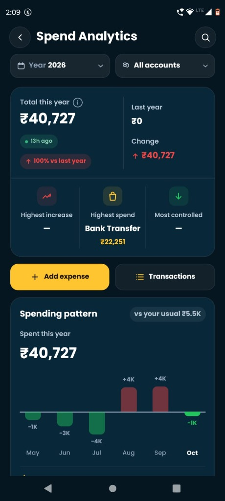
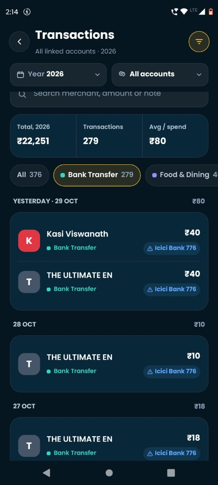

# Task 1: Simplify Money — Track & Spend Analytics Teardown

**Candidate:** Vansh  
**Device Tested:** Android (Nothing Phone / Pixel)  
**Data Source Connected:** Bank SMS (Paytm UPI linked to ICICI Bank account ending in `776`)  
**App Version:** Simplify Money (Latest 2026 Production Build)  

---

## 1. Overview & Setup

To evaluate the real Track experience, I granted the app SMS access on my personal Android phone. My primary daily spending flows through **Paytm UPI**, which is connected to my **ICICI Bank account (••776)**. I use this account constantly for day-to-day micro-expenses: chai stalls, local transit, food orders, and peer-to-peer transfers.

The app scanned my inbox and populated **376 transactions** totaling **₹40,727** for the year 2026, with an average transaction size of **₹80**.

---

## 2. Real Screenshots from My App

| Screenshot 1: Spend Analytics | Screenshot 2: Transactions Feed |
| :---: | :---: |
|  |  |
| *Year 2026 spend overview with the "Last year ₹0" anomaly and spending pattern bar chart.* | *Transaction list showing generic "Bank Transfer" tags, letter badges (K, T), and warning icon on ICICI.* |

---

## 3. Performance Breakdown: Where It Felt Fast vs. Where It Stuttered

### ⚡ Where It Felt Fast
* **Rapid Initial SMS Parsing:** Ingesting months of transactional SMS alerts took less than 4 seconds. There was no spinning loader hanging the UI—the count incremented smoothly.
* **Instant Category Pill Filtering:** In the Transactions feed ([Screenshot 2](screenshots/05_transactions_feed.jpg)), tapping between category pills (`All 376` → `Bank Transfer 279` → `Food & Dining 4`) filtered the feed instantaneously with zero observable frame drop.
* **Pull-to-Refresh Response:** Pulling down on the feed triggered a crisp haptic tap and quickly refreshed recent SMS state.

### ⚠️ Where It Stuttered, Jumped, or Made Me Wait
* **Spend Analytics Screen Transition:** Tapping from Home into "Spend Analytics" ([Screenshot 1](screenshots/04_spend_analytics.jpg)) caused a noticeable **2–3 second hitch**. The screen initially loaded blank cards, followed by an awkward layout shift as the "Spending pattern vs your usual ₹5.5K" bar chart popped into view.
* **Section Header Jitter During Rapid Fling Scroll:** When fast-scrolling through the 279 transactions in the feed, crossing the sticky date headers (`YESTERDAY · 29 OCT`, `28 OCT`, `27 OCT`) produced minor micro-stutters, indicating unoptimized header virtualization.
* **Redundant Year Dropdown Modal:** Tapping the `Year 2026` dropdown opened a bottom sheet that *only* showed "2026". Opening an interactive picker with only one selectable option added unnecessary interaction friction.

---

## 4. Inaccuracies & Confusing UX Identified

### Flaw 1: The "Last Year ₹0 / 100% Increase" Historical Cutoff Bug (Screenshot 1)
* **What I Saw:** On the Spend Analytics dashboard, the app proudly displays:
  * `Total this year: ₹40,727`
  * `Last year: ₹0`
  * `Change: ↑ ₹40,727 (↑ 100% vs last year)` in alarming red text.
* **Why It Is Wrong & Confusing:** My phone's SMS inbox contains bank alerts dating back through **2025 and 2024**. However, Simplify Money arbitrarily stopped scanning at January 1st, 2026. Because it ignored previous years, it concluded that my historical spending was ₹0 and flagged a "100% spend spike."
* **The Impact:** This violates our non-negotiables (*"Your numbers are honest"*). Seeing a dramatic red warning that your spending doubled when it's simply a parsing limitation breaks user trust in the app's analytical intelligence.

---

### Flaw 2: The 75% "Bank Transfer" Black Hole & Missing Merchant Identity (Screenshot 2)
* **What I Saw:** Out of my 376 transactions, a staggering **279 transactions (74%)** are lumped together into a generic `"Bank Transfer"` bucket totaling ₹22,251.
* **Why It Is Wrong & Confusing:** In India, small merchant UPI payments (e.g., local eateries, stationery shops, daily transit) are technically settled as bank transfers, but they represent real lifestyle expenses!
  * In my feed, multiple transactions to `THE ULTIMATE EN` (₹40, ₹10, ₹18) and `Kasi Viswanath` (₹40) are all rendered with dull single-letter circles (`[K]`, `[T]`) and tagged as "Bank Transfer".
  * Without merchant logo resolution or smart category inference, the entire feed looks like an anonymous spreadsheet of peer transfers rather than a personal money tracker.

---

### Flaw 3: The Alarming Exclamation Warning Badge on the Bank Account Pill (`! Icici Bank 776`)
* **What I Saw:** On every single transaction row in the feed, the account badge is displayed with a warning triangle: `⚠ Icici Bank 776`.
* **Why It Is Wrong & Confusing:** A yellow exclamation mark universally signals an error (e.g., *account unlinked*, *sync failed*, or *balance compromised*). Tapping the badge does nothing. In reality, my account is synced and active. Showing a persistent warning icon causes unwarranted user panic.

---

### Flaw 4: Negative Spending Bars on the Pattern Chart (Screenshot 1)
* **What I Saw:** The "Spending pattern" chart shows green bars pointing downward labeled `-1K`, `-3K`, `-4K` for May, June, and July, and red bars pointing upward labeled `+4K` for August and September.
* **Why It Is Wrong & Confusing:** While this represents variance against my "usual ₹5.5K" monthly baseline, displaying negative rupee amounts in green visually reads like **income, cashbacks, or refunds**. Several users would interpret `-4K` in July as receiving ₹4,000 back rather than spending ₹1,500 instead of ₹5,500.

---

## 5. Three High-Impact Changes I Would Make & Why

### 1. Multi-Year Historical SMS Ingestion & Honest YoY Benchmarking
* **What I Would Change:** Update the SMS ingestion worker to index the trailing 24 months of transactional messages rather than capping at the current calendar year.
* **Why:** Personal financial tracking derives its value from comparison. If a user can see:
  > *"You spent ₹40,727 so far in 2026 compared to ₹38,200 by this time in 2025 (+6.6%)"*
  the app becomes genuinely useful for budgeting and tax planning, rather than showing a misleading "100% vs last year" error.

---

### 2. Rich Merchant Enrichment with Brand Logos (Swiggy, Zomato, Uber, Ola, Rapido, Blinkit)
* **What I Would Change:** Implement an entity recognition library that maps raw UPI transaction strings to clean consumer brands, complete with **official brand logos and brand-colored icons**:
  * `SWIGGY*BANGALORE` → **Swiggy Logo** (Vibrant Orange `#FC8019`), tagged under `Food & Dining`.
  * `ZOMATO_UPI` → **Zomato Logo** (Crimson Red `#E23744`).
  * `UBER_INDIA` / `RAPIDO*RIDE` / `OLA*CABS` → **Uber/Rapido/Ola Logos**, tagged under `Daily Commute`.
  * `BLINKIT` / `ZEPTO` → **Blinkit/Zepto Logos**, tagged under `Groceries`.
* **Why:** Indian consumers recognize logos 10x faster than reading legal merchant names or VPA handles. Replacing dull generic letter circles (`[K]`, `[T]`) with authentic brand badges transforms the Track screen into a visually engaging, modern timeline.

---

### 3. Smart UPI Triage & Account Sync Status Clarity
* **What I Would Change:**
  1. **One-Tap Contact Triage:** When a user frequently sends money to the same recipient (e.g., 4 transactions to `THE ULTIMATE EN`), prompt a subtle 1-tap chip: *"Tag 'THE ULTIMATE EN' as Snacks & Dining?"* to rescue transactions from the 74% "Bank Transfer" dump.
  2. **Clean Account Health Badge:** Replace the alarming `⚠ Icici Bank 776` badge with a clean, reassuring sync indicator: a subtle bank logo accompanied by a green status dot (`● ICICI ••776 · Synced via SMS`).
* **Why:** This directly eliminates the two biggest points of user confusion: vague categorization and unexplained warning icons. It empowers users to have accurate category charts with zero manual data entry.
